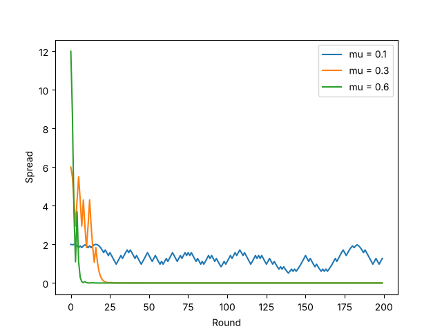
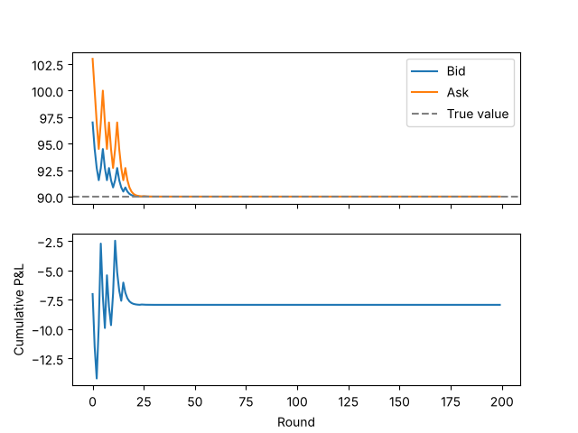

# Market Maker Simulation (Glosten-Milgrom)

A small Python simulation of a dealer who quotes a bid and an ask to a stream of traders, some of whom know the true value of the stock. It is based on the Glosten-Milgrom (1985) model of how bid-ask spreads come from adverse selection.

## How it works

- The stock's true value is either 90 or 110, chosen at random at the start. The dealer doesn't know which.
- Each round, one trader arrives. With probability μ they are informed: they buy if the value is 110 and sell if it is 90. Otherwise they are a noise trader and buy or sell 50/50.
- The dealer holds a belief p, the probability that the value is 110, starting at 0.5.
- Before each trade, the dealer sets the ask to its best estimate of the value given that the next order is a buy, and the bid to its best estimate given a sell. Both come from Bayes' rule.
- After each trade, the dealer updates its belief. Buys push it up, sells push it down.

The spread exists because the dealer can't tell informed traders from noise traders. It loses to the first group and makes it back from the second.

## Results

**The spread grows with the share of informed traders.** At the start, the spread equals μ × 20: about 2 at μ = 0.1, 6 at μ = 0.3 and 12 at μ = 0.6.

**More informed traders means faster learning.** At μ = 0.6 the quotes reach the true value in about 5 rounds, at μ = 0.3 in about 20. At μ = 0.1 each order carries little information, and in the run shown the dealer still hadn't learned the value after 200 rounds. So there is a tradeoff: few informed traders gives tight spreads but slow price discovery.



**With the correct spread, the dealer breaks even on average.** Over 2,000 runs, the average P&L is within one standard error of zero for every μ tested. Any single run can be up or down, but nearly all the P&L is made or lost in the early rounds, while the dealer is still uncertain. The risk is much higher when μ is low, because the dealer stays uncertain for longer.



**Quoting too tight loses money.** A dealer that quotes only half the correct spread loses about 22.65 on average at μ = 0.3, almost the same amount in every run.

**A fixed spread only makes money without competition.** A dealer that always quotes ±1 around its estimate earns about 155 on average, because it keeps charging after there is nothing left to learn. In a competitive market another dealer would undercut it, so this profit comes from market power, not from the model's logic.

## Running it

```bash
pip install -r requirements.txt
python3 sim.py
```

It prints the average P&L results and recreates both charts. It takes a few seconds.

## Limitations

- The dealer doesn't care about inventory. Real market makers adjust quotes when they build up a long or short position.
- Every trade is one share, and there is only one dealer.
- The true value can only take two values.
- The code breaks at μ = 1: if every trader is informed, no dealer can make a market.

## How I built it

I wrote this with Claude Code, one step at a time, and went through every line myself before moving on.
